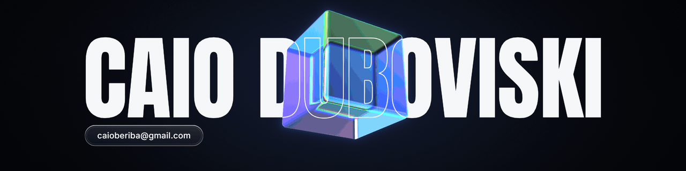

  
  
  <a href=" http://lattes.cnpq.br/5223978412050866">
    

---

  

</h3>

---

## 🇺🇸 About Me

I'm **Caio Duboviski** (*Caio Duboviski Beribá*), an undergraduate student and researcher in **Artificial Intelligence and Software Engineering (IAES)** at the Federal University of Paraná (UFPR), Brazil. I'm a **Full-Stack Developer** with a strong focus on front-end development, passionate about artificial intelligence, software engineering, and building innovative digital products.

- 🔬 **Research (2026–Present):** My research focuses on **integrating LLM-based multi-agent systems into the software development lifecycle**, exploring intelligent agents for code generation, review, and debugging. **Fundação Araucária (PIBITI)**

- 🚀 **Industry & Product Development:** Partner and developer at **[Alatus Soluções Digitais](https://alatus.ia.br)** (2026–Present), working on web applications, custom B2B solutions, SaaS products, and automation, with an emphasis on modern interfaces, user experience, and scalable software.

- 💻 **Software Development:** Experience with **React, TypeScript, JavaScript, Node.js**, API integrations, and low-code development. Involved in projects such as **Alatus Website**, **BR Veículos** (full-stack development), and **LastClick CRM**, a SaaS platform integrating AI agents with WhatsApp.

- 🌐 **Portfolio:** [Personal Portfolio](https://duboviski-site.vercel.app/)

---

## 🇧🇷 Sobre Mim

Sou **Caio Duboviski** (*Caio Duboviski Beribá*), graduando e pesquisador em **Inteligência Artificial e Engenharia de Software (IAES)** na Universidade Federal do Paraná (UFPR, Campus Avançado de Jandaia do Sul, Paraná, Brasil). Desenvolvedor **full-stack**, interessado em inteligência artificial, engenharia de software e desenvolvimento de produtos digitais.

- 🔬 **Pesquisa (2026–atual):** Pesquisa sobre **integração de sistemas multiagentes baseados em LLMs ao ciclo de vida de desenvolvimento de software**, com foco em agentes inteligentes para geração, revisão e correção de código. **PIBITI/Fundação Araucária**

- 🚀 **Indústria e Produto:** Sócio e desenvolvedor na **[Alatus Soluções Digitais](https://alatus.ia.br)** (2026–atual), atuando no desenvolvimento de aplicações web, soluções B2B, produtos SaaS e automações, com ênfase em interfaces modernas, experiência do usuário e soluções escaláveis.

- 💻 **Desenvolvimento de Software:** Experiência com **React, TypeScript, JavaScript, Node.js**, integrações de APIs e desenvolvimento low-code. Participação em projetos como **Alatus Website**, **BR Veículos** (desenvolvimento full-stack) e **LastClick CRM**, plataforma SaaS com integração de agentes de IA ao WhatsApp.

- 🌐 **Portfólio:** [Portfólio pessoal](https://duboviski-site.vercel.app/)

---

## 🛠️ Stack

**Languages**

  
  
  
  
  

**AI & Agents**

  
  
  
  
  

**Backend & Data**

  
  
  
  
  
  
  

**Frontend**

  
  
  
  

**Infra & DevOps**

  
  
  

---

## 🌐 Languages
🇧🇷 **Português** (Nativo) · 🇺🇸 **English** (B1 PET — Cambridge English Qualifications)

---

## 📊 GitHub

  <picture>
    <source media="(prefers-color-scheme: dark)" srcset="https://streak-stats.demolab.com?user=DuboviskiCaio&theme=github-dark-blue">
    <source media="(prefers-color-scheme: light)" srcset="https://streak-stats.demolab.com?user=DuboviskiCaio&theme=default">
    
  </picture>
  <picture>
    <source media="(prefers-color-scheme: dark)" srcset="https://github-stats-extended.vercel.app/api/top-langs/?username=DuboviskiCaio&layout=compact&theme=github_dark">
    <source media="(prefers-color-scheme: light)" srcset="https://github-stats-extended.vercel.app/api/top-langs/?username=DuboviskiCaio&layout=compact&theme=default">
    
  </picture>

<picture data-importer="pacman">
  <source media="(prefers-color-scheme: dark)" srcset="https://raw.githubusercontent.com/duboviskicaio/duboviskicaio/pacman-output/pacman-contribution-graph-dark.svg?game=pacman">
  <source media="(prefers-color-scheme: light)" srcset="https://raw.githubusercontent.com/duboviskicaio/duboviskicaio/pacman-output/pacman-contribution-graph.svg?game=pacman">
  
</picture>

---

  Get in touch via <a href="https://www.linkedin.com/in/caioduboviskiberiba">LinkedIn</a> or <a href="https://duboviski-site.vercel.app/">Portfolio</a> 
  © 2026 Caio Duboviski

